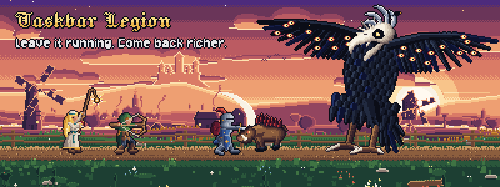
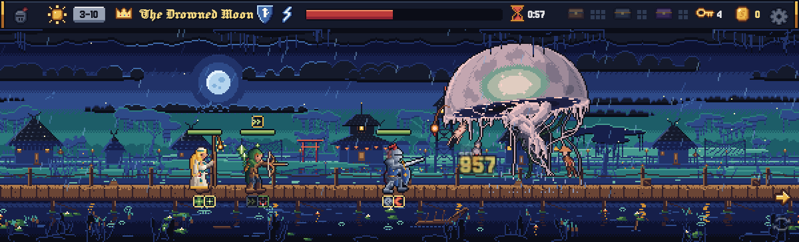
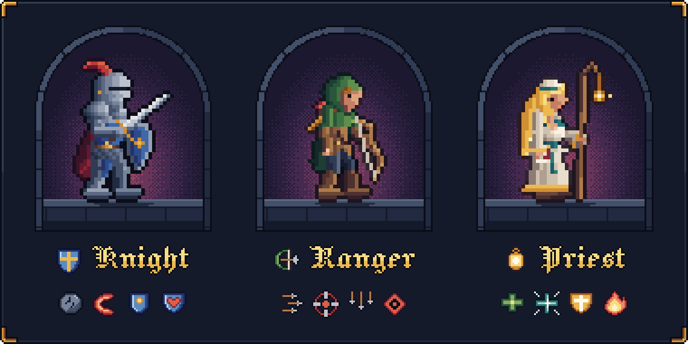
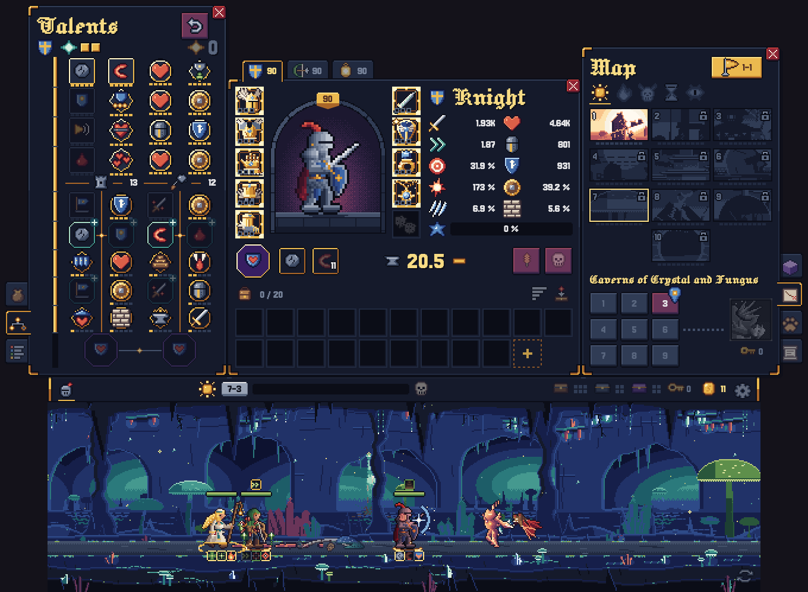
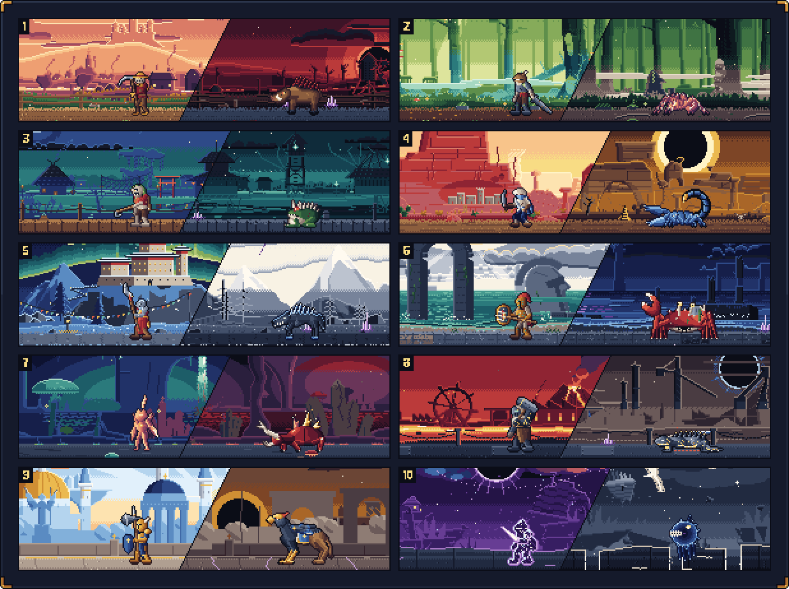
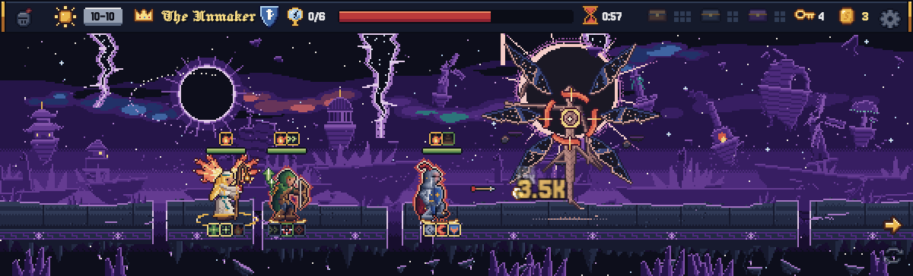

<div align="center">



**A tiny auto-battling RPG that lives at the bottom of your screen.**

[Download](https://github.com/Nyhz/taskbar-legion/releases) · English · Español (España)

</div>

---

## What is this?

**Taskbar Legion** is an idle RPG that plays out in a thin strip along the bottom of your
desktop, quietly, while you do everything else. Your party of three heroes marches ever
rightward, hacking through ten worlds of monsters. You don't control the swinging;
you control the *build*. Pop in now and then to crack open chests, slot a shinier sword,
spend a talent point, and shove your legion a little deeper into the world.

Then you close the panel and let them fight on.

<div align="center">



<sub>The real thing: the party against the Drowned Moon, world boss of the Stilt Marshes.</sub>

</div>

## Your legion

<div align="center">



</div>

Three heroes, one job each. You start with a lone Knight and recruit the other two as you go.
The trio is the whole party, so every fight is won or lost on how well you gear and build them
together.

- **Knight**: the wall. Blocks, soaks the hits meant for the heroes behind him, and has
  to have a defence ready when a boss winds up its big swing.
- **Ranger**: the damage. Rapid fire, aimed shots and rains of arrows; marks a boss so the
  whole party hits it harder.
- **Priest**: the lifeline. Heals, shields, and keeps the back line standing. Without her,
  the late walls don't fall.

Each hero has their own **talent tree**: a shared trunk of abilities, then a choice between
two branches (Bastion or Scourge, Marksman or Stalker, Devotion or Zeal), and a capstone at the
top. At level 30 each one unlocks an **ultimate** that fires on its own. Respecs are free, and
every hero keeps two saved builds, one for farming and one for bosses.

## How it plays

It's a loop, and it's a good one:

1. **They fight on their own.** Heroes auto-attack and fire off their abilities as they
   advance, stage by stage: `1-1 → 1-2 → … → 1-9`.
2. **Kills fill a bar.** Clear enough waves and a **stage boss** rears up. Beat it to move on.
3. **Loot comes in chests, not corpses.** Kills drop **chests** now and then (common, stage-boss
   and world-boss), with limited storage, so you'll want to open them. Cracking one rolls the
   actual gear.
4. **Gear up.** Every drop has a rarity, from grey **Normal** to rainbow-shimmering
   **Primordial** (nine in all). Better rarities roll more affixes and more sockets for
   **gems**. Armour is cut for one class (plate, leather, cloth); rings, amulets and trinkets
   fit anyone.
5. **Build your heroes.** Spend talent points, buy **upgrades** with your gold (more gold,
   more XP, bigger chest storage, auto-opening chests…), and put the **Cube** to work: merge
   nine items into one of the next rarity, melt the junk into gold, or reroll an affix you
   don't like.
6. **Hit a wall. Break it.** Each world ends at stage 10 with a **world boss**, a hard gate
   that says *"come back when you're stronger."* So you go farm, gear up, and come back
   stronger.

<div align="center">



<sub>The hero window, with the talent tree and the map docked beside it.</sub>

</div>

## Ten worlds, five difficulties

The climb is finite and it is long: **ten worlds** of ten stages, played through **five
difficulties** (Normal, Hell, Inferno, Eternal, Torment). Beat a difficulty's last world
boss and the next one opens, meaner and better-paying, with your heroes, gear and upgrades
coming along. Torment repaints every world in its own nightmare.

<div align="center">



<sub>Golden Meadows, Old Moss Forest, the Stilt Marshes, Red Rock Canyons, Monastery Peaks,
the Coast of Sunken Ruins, the Caverns of Crystal and Fungus, the Ash Lands, the Citadel among
the Clouds and the Rift. Normal on the left of each tile, Torment on the right.</sub>

</div>

**World bosses fight back.** Each one has a mechanic of its own (a flock of crows, grasping
roots, chain bolts, mirrors that shatter over the party…). They enrage if the fight drags
on, and from Inferno on they telegraph a **Charged Strike** that tests your tank's defences.
Every boss hits mostly physical or mostly magic, so armour alone won't save you. Archers
shoot past your Knight, and area blows splash the whole party. A world boss also costs a
**key** per attempt: the first clear of a world's ninth stage hands you one, and boss chests
hide more.

Your power comes from **gear** first, then **level** (up to 120), **talents** and
**ultimates**, all stacking together. Coast on last difficulty's loot and you'll stall at the
next wall; keep every part of your build moving and the legion keeps rolling. Clearing Torment
is a **months-long** haul (well over a thousand hours of play), and it's a game you can check on
for thirty seconds or stare at for an hour. Both are correct.

<div align="center">



<sub>The last door of each difficulty: the Unmaker, at the heart of the Rift.</sub>

</div>

## Lives on your desktop

Taskbar Legion ships as a **transparent, always-on-top desktop overlay** (Windows, macOS,
Linux): borderless, sitting over the bottom of your screen, and clicking *through* to whatever's
behind it until you reach for one of its panels. Drag the strip to move it wherever you like,
and pick a game size that fits your screen. Your heroes fight in the margins of your actual work.

**Close it and they keep earning.** While the game is shut, your legion banks gold and XP (up
to eight hours of it, at half pace until you upgrade it; the right pet stretches the hours), and
a *"while you were away"* summary greets you when you're back.

**Pets** are the rarest drop in the game: six of them, each a permanent bonus to your gold,
XP, chests or time away. You may go a whole difficulty without seeing one.

The whole game is in **English and Spanish (Spain)**. It follows your system language, and you
can switch in the options.

## Play it

Grab an installer for your OS from the [Releases](https://github.com/Nyhz/taskbar-legion/releases)
page (`.dmg` for macOS, `.exe` for Windows, `.AppImage` or `.deb` for Linux).

Building from source:

```bash
npm install
npm run tauri:dev   # run the desktop app
npm run dev         # or just the game in a browser, for fast iteration (progress isn't saved there)
```

No account, no server, no internet. It's 100% offline, and your save lives on your own machine
(you can export it from the options).

## License

The source is **available to read, build, and play for personal / noncommercial use** under the
[PolyForm Noncommercial 1.0.0](./LICENSE.md) license. Commercial use requires a separate license.
© 2026 Daniel Calvo.

---

<sub>**Building or hacking on it?** The original design lives in [`SPEC.md`](./SPEC.md), the
build manual and house rules in [`CLAUDE.md`](./CLAUDE.md), the scaling model in
[`docs/DIFFICULTY.md`](./docs/DIFFICULTY.md), and the redesign in [`docs/redesign/`](./docs/redesign/).
The art is drawn by the Python asset pipeline in [`tools/assets/`](./tools/assets/); the banners
above are composed from the game's own exported sprites (`sh tools/assets/run.sh readme`), and the
screenshots are captured from the running game. Built with TypeScript · Vite · PixiJS · React ·
Zustand, wrapped for desktop with Tauri.</sub>
